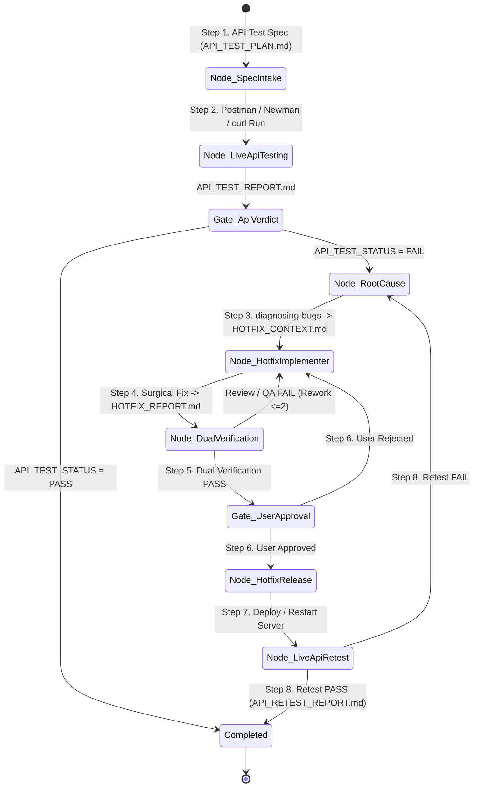

<!-- TEMPLATE_VERSION: 1.0.0 -->
---
description: Closed-loop Backend Live API / Postman Verification & Surgical Hotfix Pipeline (API Test Plan -> Newman/curl Execution -> Root Cause -> Surgical Fix -> Dual Verification -> User Gate -> Live API Retest).
---

# Live API / Postman Test & Surgical Hotfix Workflow

## Token Optimization & Caveman Mode
Execute all phases under the `caveman` protocol: terse technical signal, zero conversational filler, redacted secrets (`<REDACTED>`), and deterministic Outside Judge verification.

This workflow is the backend counterpart to `live-test-and-hotfix.md`. Use it when auditing API endpoints, verifying bug reports via Postman/Newman or `curl`, and surgically fixing defects with full regression verification.

---

## Agent Roster & Ownership
| Role | Agent | Responsibility |
| :--- | :--- | :--- |
| **Spec Author** | `task-context-builder` or `code-reviewer` | Authors `.agent-work/<TASK_ID>/API_TEST_PLAN.md` with target routes, auth roles, payload matrices, and expected status/schema invariants. |
| **Live API Tester** | `live-api-tester` | Drives live local/staging API via Postman CLI/Newman or `curl` (`api-postman-testing`). Captures redacted responses, latency, and server logs into `API_TEST_REPORT.md`. |
| **Hotfix Engineer** | `implementation-engineer` | Uses `diagnosing-bugs` to isolate root cause, writes a failing regression test first (`tdd`), and applies a minimal surgical fix (`HOTFIX_PLAN.md` → `HOTFIX_REPORT.md`). |
| **Dual Verifiers** | `code-reviewer` + `qa-validator` | Parallel audit: two-axis `code-review` (Standards + Spec + `caveman-review` vectors) & full test suite + static analysis (Outside Judge). |
| **Release Manager** | `release-manager` | Enforces User Approval Gate, updates memory/changelog, formats `caveman-commit` + `pr`, and triggers post-deploy live API retest. |

---

## Execution Steps
1. **API Test Plan (`API_TEST_PLAN.md`)**: List exact endpoints, HTTP methods, auth roles, happy-path payloads, `422` invalid payloads, `401`/`403` IDOR/tenancy negative probes, and Postman collection path (if present).
2. **Live API Execution (`live-api-tester`)**: Run `npx newman run ...` or scripted `curl` against the running server. Record exact status codes, latencies, and redacted responses in `API_TEST_REPORT.md`. If `PASS`, stop and report.
3. **Root-Cause Isolation (`diagnosing-bugs`)**: Turn the failing HTTP call into a fast, deterministic local repro test. Rank 3–5 falsifiable hypotheses. Write `HOTFIX_CONTEXT.md`.
4. **Surgical Hotfix (`implementation-engineer`)**: Lock the bug with a failing regression test, apply the minimal fix respecting `backend-security-and-db` invariants (transactions, N+1, tenancy, validation), and verify the test flips red → green.
5. **Parallel Dual Verification**: Run `code-reviewer` (`caveman-review` + `code-review`) and `qa-validator` (full automated test suite + typecheck/linter). Max 2 rework loops.
6. **User Approval Gate**: Present diff summary, test results, and Merge Danger (`pr` skill) for explicit user sign-off.
7. **Release & Live API Retest**: Commit (`caveman-commit`), push/deploy, and re-run the exact Postman/Newman or `curl` suite from Step 2 to produce `API_RETEST_REPORT.md` (`PASS`).
