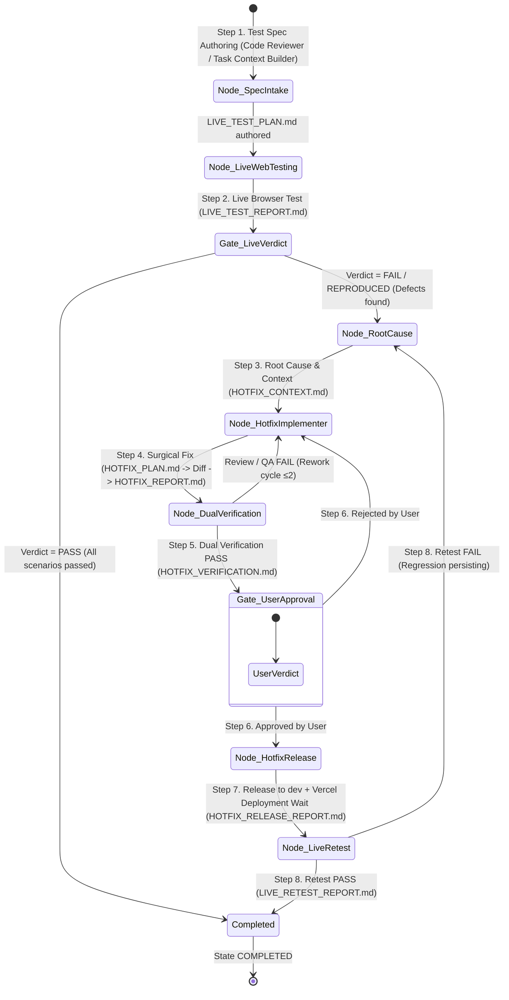

<!-- TEMPLATE_VERSION: 1.0.0 -->
---
description: Closed-Loop Live Verification & Rapid-Healing Pipeline (Live Test Plan -> Playwright MCP Execution -> Live Verdict -> Fast-Track Hotfix -> Dual Verification -> Release & Retest).
---

# Live Audit, Test & Hotfix Workflow — Closed-Loop QA & Healing Pipeline

## Overview

This workflow establishes a **closed-loop live verification and rapid-healing pipeline**. It bridges test planning, real browser automated execution, diagnostic defect isolation, surgical hotfixing, dual verification, release, and post-deployment live retest verification.

Use this workflow when auditing a subsystem, verifying open bug reports, running targeted regression tests on live environments (`production/preview` at `https://<your-preview-domain>.vercel.app` or `local` at `http://localhost:3000`), and immediately correcting any discovered defects through the verified hotfix engine.

---

## Agent Roster & Ownership

| Agent Role | System Persona / Agent Route | Primary Responsibilities in this Workflow |
|:---|:---|:---|
| **Spec Author & Auditor** | `code-reviewer` (`.agents/agents/code-reviewer/`) or `task-context-builder` (`.agents/agents/task-context-builder/`) | Analyzes open issues, user reports, or target modules; drafts deterministic, modular test cases with exact routes, actions, DOM assertions, and test credentials. |
| **Live Browser Specialist** | `live-web-tester` (`.agents/agents/live-web-tester/`) | Drives headless/headed browser sessions via Playwright MCP & Chrome DevTools MCP against live targets (`https://<your-preview-domain>.vercel.app` or `http://localhost:3000`). Traps console errors, hydration mismatches, and visual regressions. Outputs `LIVE_TEST_REPORT.md`. |
| **Hotfix Engineer** | `implementation-engineer` (`.agents/agents/implementation-engineer/`) | Performs root-cause analysis; drafts `HOTFIX_PLAN.md`; executes surgical, minimal code edits adhering strictly to existing invariants and avoiding ad-hoc UI band-aids. Outputs `HOTFIX_REPORT.md`. |
| **Code Reviewer** | `code-reviewer` (`.agents/agents/code-reviewer/`) | Conducts adversarial diff reviews on hotfixes checking security, multi-tenancy, layering, and regression risks. Participates in Parallel Dual Verification. |
| **QA Validator** | `qa-validator` (`.agents/agents/qa-validator/`) | Audits type safety (`bunx tsc --noEmit`), lint compliance (`bunx eslint <file>`), and assertion criteria. Participates in Parallel Dual Verification. |
| **Release Manager** | `release-manager` (`.agents/agents/release-manager/`) | Enforces user sign-off gates; updates `.agents/MEMORY.md` and archive; commits with conventional commit messages; pushes bugfix branch, merges into `dev`, pushes `dev`, and pulls `dev`. |

---

## Execution Steps

### Phase 1: Test Plan & Live Verification

#### Step 1: Spec Intake & Test Case Authoring (`code-reviewer` / `task-context-builder`)
1. **Intake**: Review the user's target module, open issue document (e.g. `IS-XXX`), or recent commit range.
2. **Action**: Author a structured test plan:
   - File path: `.agent-work/<TASK_ID>/LIVE_TEST_PLAN.md`.
   - Define exact routes, role preconditions, test credentials, step-by-step UI actions, and concrete DOM element assertions.
   - Include negative security guards (e.g. role access denials, 403, 422 duplicate collisions).
3. **Transition**: Hand off to `live-web-tester`.

#### Step 2: Live Browser Execution (`live-web-tester`)
1. **Preflight**: Verify target URL is reachable (`https://<your-preview-domain>.vercel.app` or `http://localhost:3000`).
2. **Action**:
   - Execute all test scenarios in the plan using Playwright MCP tools (`browser_navigate`, `browser_snapshot`, `browser_click`, `browser_fill_form`, `browser_wait_for`, `browser_console_messages`, `browser_take_screenshot`).
   - Monitor browser console for unhandled errors, warnings, and React hydration mismatches.
   - Inspect network round-trips for unexpected 4xx/5xx responses.
   - Test responsive layout and modal lifecycle (closing, reload retention, scroll lock release).
   - Capture screenshot evidence in `.agent-work/<TASK_ID>/screenshots/`.
   - **Always close the browser session** via `browser_close` to prevent orphaned processes.
3. **Output**: Produce `.agent-work/<TASK_ID>/LIVE_TEST_REPORT.md`.
4. **Branching Gate (`gate_live_verdict`)**:
   - **PASS**: All scenarios pass with zero console errors. Workflow completes successfully!
   - **FAIL / REPRODUCED**: One or more defects reproduced. Advance immediately to **Phase 2 (Hotfix Pipeline)**.

---

### Phase 2: Hotfix & Surgical Remediation

#### Step 3: FastContext Auto-Capture & Root Cause Analysis (`task-context-builder` / `implementation-engineer`)
1. **Action**:
   - Generate or confirm `TASK_ID` (`IS-XXX` or `HOTFIX-YYYYMMDD-HHMM`).
   - Trace visible symptoms to root data flow, state slice, or component invariants.
   - Consult `.agents/memory/INDEX.md` and relevant domain chunk in `.agents/memory/domains/`.
   - Audit blast radius across downstream consumers and sibling routes.
2. **Artifact**: `.agent-work/<TASK_ID>/HOTFIX_CONTEXT.md`.
3. **Gate**: No pre-implementation pause gate. Immediately waterfall to Step 4.

#### Step 4: Surgical Implementation (`implementation-engineer`)
1. **Action**:
   - Draft `.agent-work/<TASK_ID>/HOTFIX_PLAN.md` with exact lines to touch and regression risks.
   - Apply smallest surgical fix adhering strictly to system invariants (100% `messages/en.json` localization, `Result<T>` envelope, URL/header tenancy scoping).
   - Validate with `bunx tsc --noEmit` and targeted `bunx eslint "<file>"`.
   - Self-review via `git diff`.
2. **Artifacts**: `HOTFIX_PLAN.md`, `HOTFIX_REPORT.md`.

#### Step 5: Fast-Track Dual Verification (`code-reviewer` + `qa-validator` in Parallel)
1. **Parallel Execution**:
   - **Code Reviewer**: Audits `git diff` against codebase standards, multi-tenant isolation, security, and blast radius. Reviews via `🔴 bug:`, `🟡 risk:`, `🔵 nit:`, `❓ q:`.
   - **QA Validator**: Validates compiler typecheck (`bunx tsc --noEmit`), targeted ESLint, and sanity assertion matrix (`[PASS|FAIL] <check>: <evidence>`).
   - If either returns FAIL, **short-circuit**: immediately return to Step 4 for rework (max 2 cycles).
2. **Artifact**: `.agent-work/<TASK_ID>/HOTFIX_VERIFICATION.md` (`STATUS: PASS | FAIL`).
3. **Gate**: Once both PASS, advance to Step 6.

#### Step 6: User Fast Verdict Gate
1. **STOP AUTOMATION**. Present concise summary to user:
   - What changed (files + concise diff summary)
   - Logic flow (2-3 lines)
   - Verification status (`STATUS: PASS`)
2. **Wait for explicit human sign-off** (`approved`, `lgtm`, `ship it`).
3. **Branching**:
   - **Rejected / Changes Requested**: Return to Step 4.
   - **Approved**: Advance to Step 7.

#### Step 7: Fast-Track Release & Memory Sync (`release-manager`)
1. **Action**:
   - **Direct Knowledge Sync (`.agents/memory/`)**: If the hotfix established a new invariant, pattern, or domain rule, update `.agents/memory/conventions.md` or the target domain chunk in `.agents/memory/domains/` immediately.
   - **Two-Tier Changelog Logging**:
     - Append full release entry to `.agents/MEMORY_ARCHIVE.md`.
     - Append 1-line pointer row to `.agents/MEMORY.md` §2 (`Recent Feature & Hotfix Log`) and §7 (`Release Pointers`).
   - **Git Operations (`caveman-commit`)**:
     - Create bugfix branch (`fix/<slug>` or `fix/<task-id>`).
     - Commit with conventional commit message (`fix(<scope>): <concise description>`).
     - Push bugfix branch to `origin`.
     - Switch to `dev`, merge bugfix branch, push to `origin/dev`, and pull `origin/dev` to sync local workspace.
2. **Artifact**: `.agent-work/<TASK_ID>/HOTFIX_RELEASE_REPORT.md`.

---

### Phase 3: Deployment Wait & Live Retest

#### Step 8: Live Retest Verification (`live-web-tester`)
1. **Deployment Gate**: Ensure Vercel or dev server has completed deploying the hotfix commit SHA before initiating browser automation.
2. **Action**:
   - Launch Playwright MCP against the live environment (`https://<your-preview-domain>.vercel.app` or `http://localhost:3000`).
   - Execute the exact test scenarios that previously failed.
   - Confirm DOM elements, network responses, and formatting match expected state.
   - Capture post-fix screenshots in `.agent-work/<TASK_ID>/screenshots-retest/`.
   - Close browser session cleanly with `browser_close`.
3. **Artifact**: `.agent-work/<TASK_ID>/LIVE_RETEST_REPORT.md`.
4. **Outcome**:
   - **PASS**: Task is fully verified and resolved in production/staging! Workflow completed.
   - **FAIL**: Regression persisting. Return to Step 3 for root cause reassessment.

---

## Invariants & Rules

1. **No Untested Releases**: Every hotfix must be live-verified in an actual browser session post-deployment.
2. **No Code Edits by Testers**: `live-web-tester` and `code-reviewer` are read-only / diagnostic agents; only `implementation-engineer` edits production code.
3. **No Premature Retesting**: Never spawn `live-web-tester` while a deployment is still building; always confirm the commit is live first.
4. **Always Clean Sessions**: Browser sessions must clear cookies between tenant roles and call `browser_close` upon completion to prevent orphaned browser processes.
5. **No Phantom Scripts**: State transitions and artifacts are managed directly via markdown files in `.agent-work/<TASK_ID>/`; do not invoke non-existent script paths.
6. **Dual Verification Mandatory**: Code Review and QA Validation must both pass before presenting the change to the user.
7. **User Sign-Off Non-Negotiable**: No code may be committed or merged to `dev` without explicit human verdict.
